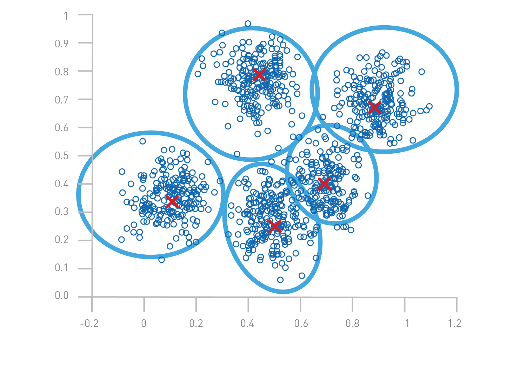

# Clustering Research

> Por trás de cada tentativa, existe uma trajetória de aprendizagem. O desafio é encontrar os padrões que os números, sozinhos, não revelam.

A popularização da inteligência artificial generativa traz novas perguntas para o ensino de programação: **como os alunos constroem suas soluções e o que muda nesse processo ao longo do tempo?**

Este projeto de iniciação científica investiga registros de atividades de estudantes no CodeBench para explorar essas perguntas com ciência de dados. A proposta é utilizar **clustering** para identificar perfis de resolução de exercícios e investigar como sua frequência varia entre diferentes semestres, no contexto da disponibilidade de ferramentas de IA.

  
   
  Ilustração de agrupamento de dados · Crédito: NVIDIA.

## Pergunta de pesquisa

**Quais perfis de resolução aparecem nos logs dos alunos e como eles se distribuem ao longo dos semestres?**

## Ponto de partida

O estudo começará com um recorte de exercícios e características como quantidade de submissões, tempo ativo estimado, edições e intervalos entre tentativas. Com **Python, pandas e scikit-learn**, serão exploradas a qualidade dos dados, a formação de grupos e sua interpretação no contexto educacional.

Os logs permitem observar comportamentos registrados, mas **não comprovam, isoladamente, o uso de IA ou seus efeitos sobre a aprendizagem**. Essa distinção orienta a interpretação dos resultados.

---

**Status:** fase inicial de definição do escopo e estudo da metodologia.
